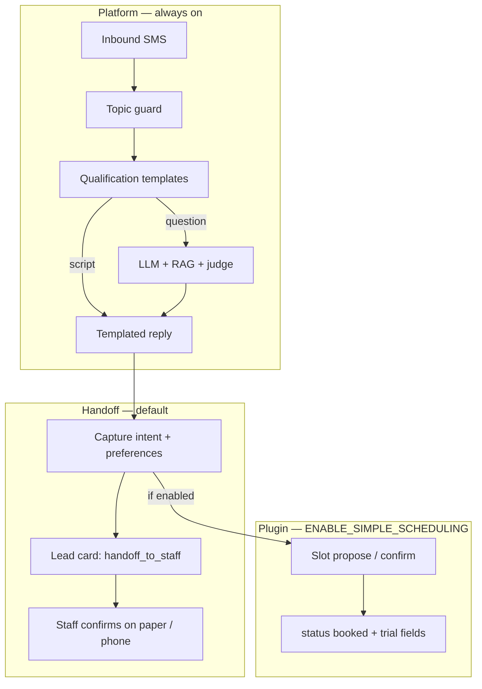

# Platform + handoff defaults (capability plugins later)

## Goal

The **template** should feel right for a paper-based business on day one: SMS receptionist that qualifies, answers from knowledge, captures **intent** (service, preferred times, child age), and **hands off to staff** — not a booking system.

**Plugins** (separate vertical modules, added when clients need them):

| Plugin | When | Status |
|--------|------|--------|
| *(none)* — handoff only | Default template, music school v1, tuition v1 | **This plan** |
| `scheduling-simple` | MMA gym, single coach / one session per slot | **This plan** (flag only) |
| `scheduling-allocated` | Music school: teachers, rooms, concurrent classes, capacity | **Later** |
| `multi-location` | Multi-branch gyms / franchises | **This plan** (flag only) |

## Architecture



### Capability flags (wrangler.toml)

Mirror `ENABLE_DEMO_TOOLS` pattern:

```toml
# Template defaults — all off
ENABLE_SIMPLE_SCHEDULING = "false"
ENABLE_MULTI_LOCATION = "false"
```

| Flag | When true |
|------|-----------|
| `ENABLE_SIMPLE_SCHEDULING` | Schedule settings UI, schedule→knowledge sync, `runHumanBookingFlow`, trial propose/confirm in pipeline, post-booking flow, LLM slot detection |
| `ENABLE_MULTI_LOCATION` | Settings venue list, `location` in default required_fields, `{{location_names}}` in templates, location resolution in qual |

**Web app** cannot read wrangler.toml directly. Expose via:

- `GET /admin/capabilities` → `{ simpleScheduling, multiLocation }` (from env vars), or
- `NEXT_PUBLIC_*` in client `.env.local` at setup time (less ideal — drifts from worker)

Prefer **API endpoint** so one source of truth.

### Vertical profiles (git, not D1)

```
profiles/
  generic.json           # handoff only, generic preset
  martial-arts.json      # scheduling + multi_location + martial-arts preset
  music-school.json      # handoff only (for now), music-school preset
  tuition-centre.json    # handoff only, tuition preset
scripts/
  apply-profile.mjs      # patch client wrangler.toml + optional D1 preset SQL/curl
```

Operator runs once at client fork:

```bash
node scripts/apply-profile.mjs music-school --wrangler workers/api/wrangler.toml
# then deploy, staff applies preset in UI or script hits apply-preset API
```

## What changes in code

### 1. Pipeline (`workers/api/src/ai/pipeline.ts`)

Introduce `schedulingEnabled(env)` in `workers/api/src/capabilities.ts`.

When **scheduling off**:

- Skip `loadScheduleForLead` for booking (optional: still load for RAG if schedule chunks exist from legacy data)
- Skip `runHumanBookingFlow` entirely
- Skip `resolveScheduleChoice` / `confirmTrial` / `proposeTrial` blocks
- Skip post-booking handler for trial state
- Skip LLM post-processing that writes trial bookings
- LLM + judge still run; system prompt says **do not confirm bookings** — capture preferences and say staff will follow up

When **scheduling on**: current behaviour unchanged.

### 2. Handoff behaviour (new / updated)

**Lead state** (use existing fields where possible):

- After qualification complete → `status: engaged`, `assessment: "Handoff — awaiting staff"`
- On preferred times in message → append to lead notes or new optional `handoff_json` column (prefer **notes** first to avoid migration)
- `learnFromMessage` already extracts name/interest; extend to detect `preferred_times` phrase → staff note

**AI copy** (`prompt.ts`, presets):

- `PLATFORM_SMS_PLAYBOOK`: when scheduling off, "offer to pass details to the team; never confirm a slot unless scheduling is enabled"
- `generic-service.json` `qualified` template:
  - From: `which days work best for a {{trial_label}}?`
  - To: `what days or times usually work for you? Someone from the team will confirm.`

**Default `required_fields`**: `["name", "interest"]` — drop `location` unless `ENABLE_MULTI_LOCATION`.

### 3. Settings UI (`apps/web`)

- Fetch capabilities on load
- **Hide** Schedule section entirely when `!simpleScheduling`
- AI section unchanged (personas, presets, templates)
- Sidebar: `Configuration` → AI, Team, Demo (no Schedule by default)

### 4. Locations / schedules (keep code, gate UI + writes)

- Do **not** delete `locations`, `location_programme_schedules`, schedule-knowledge — phiof and future gym clients need them
- Admin location APIs remain; UI hidden when scheduling off
- Fresh template deploy: empty D1, no location rows, no Schedule nav

### 5. phiof instance

Explicit client profile in `pdc-phiof/workers/api/wrangler.toml`:

```toml
ENABLE_SIMPLE_SCHEDULING = "true"
ENABLE_MULTI_LOCATION = "true"
```

Keeps demo gym behaviour without shaping the template default.

### 6. Documentation

- `docs/client-setup.md` — profile matrix, apply-profile, what handoff means for staff
- `docs/plugins.md` — stub for future `scheduling-allocated`; what's in vs out of scope
- README: "Configure AI for a new client" links here

## Out of scope (explicit)

- Teacher/room/capacity model
- Concurrent class allocation
- Calendar UI for music schools
- Replacing paper timetables
- Migrating phiof's 4 legacy cities (operator can rename/delete manually)

## Success criteria

- Fresh template + empty D1: Settings shows **AI only** (no Schedule); SMS never mentions Manchester/BJJ/trial slots unless configured
- Inbound "Tuesday works" → note on lead + reassuring SMS, **no** `booked` status without scheduling flag
- `apply-profile martial-arts` on a client repo → scheduling UI appears, booking flow works as today
- phiof with flags on: unchanged gym demo experience
- New music-school client with `music-school` profile: handoff copy, child-friendly preset, no calendar

## Implementation order

1. **capabilities** — env, helper, API, tests
2. **pipeline gate** — handoff path when scheduling off
3. **presets + qual defaults** — generic handoff copy, location optional
4. **Settings UI** — hide Schedule
5. **profiles + apply-profile script**
6. **docs + phiof wrangler**
7. **tests + manual SMS smoke**

## Estimated touch points

| Area | Files |
|------|--------|
| Capabilities | `env.ts`, `capabilities.ts`, `routes/admin.ts` or new route, `index.ts` |
| Pipeline | `pipeline.ts`, `run-booking-flow.ts` (early return), `prompt.ts` |
| Qualification | `ai-qualification-config.ts` defaults, `generic-service.json` |
| Web | `SettingsWorkspace.tsx`, `lib/api/capabilities.ts` |
| Profiles | `profiles/*.json`, `scripts/apply-profile.mjs` |
| Docs | `docs/client-setup.md`, `docs/plugins.md`, `README.md` |
| Client | `pdc-phiof/wrangler.toml` |
